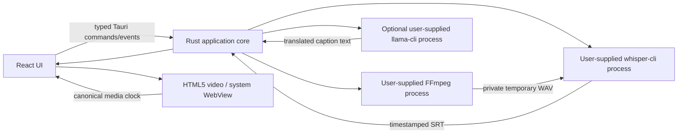
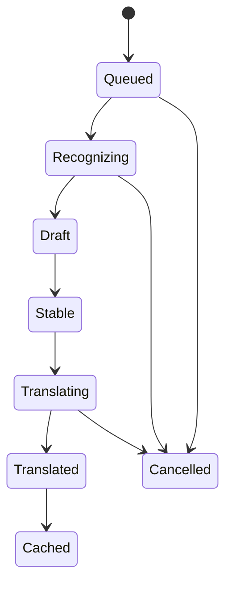

# Architecture overview

Status: runnable prototype
Last reviewed: 2026-07-26

## Goals

Playdub plays local video while producing translated subtitles on the same device. It must remain
responsive when inference is slow, unavailable, cancelled, or crashed.

The desktop targets are macOS, Windows, and Linux. Mobile is intentionally outside the first
implementation milestone because its player and acceleration layers need platform-specific work.

## System context



## Process boundaries

### WebView

Owns presentation, accessibility, user intent, and transient UI state. It receives only the paths
and data required to render the interface. It cannot launch processes or access arbitrary files.
The static asset-protocol scope is empty. Tauri's native file dialog grants the selected video to
the runtime scope for that session, so Playdub does not persist or globally allow home-directory
media access.

### Rust application core

Owns trusted orchestration:

- playback and current media session;
- file-dialog and path validation;
- task priorities and cancellation;
- external executable and model configuration;
- inference process lifecycle and output validation;
- subtitle task state and SRT/WebVTT export; and
- Tauri capability enforcement.

Use domain services behind small traits so timestamp, task, and cache behavior can be tested without
a Tauri runtime.

### Playback adapter

The prototype uses the system WebView's HTML5 video implementation. It is intentionally dependency
light, but format and codec support varies across macOS, Windows, and Linux. MP4 with H.264/AAC is
the safest test format. libmpv embedding, broad demux/codec coverage, audio-track selection, and HDR
remain future work and require an approved legal and architecture decision.

Playback time is the only canonical clock. Wall-clock time and inference completion time must never
be used to place captions.

### Prototype inference adapter

ASR and translation execute in user-selected external CLI processes started by the trusted Rust
core. The current batch pipeline is:

1. FFmpeg decodes the selected media into a private 16 kHz mono WAV working file.
2. `whisper-cli` generates an SRT transcript with media timestamps.
3. For an English target, a separate Whisper translation pass produces English captions.
4. For another target language, optional `llama-cli` translates caption text with a user-selected
   instruction-capable GGUF model.

The tools and models are never downloaded or bundled by Playdub. Process arguments are passed
without a shell, paths are selected through trusted dialogs, output is bounded and parsed as
untrusted data, and temporary files are deleted on normal completion. A task generation ID prevents
late results from replacing a newer media session.

This prototype processes a batch rather than a true streaming look-ahead window. It demonstrates
the complete local pipeline, but VAD, chunk scheduling, crash-isolated workers, incremental
captions, persistent caching, active child-process cancellation, and worker protocol versioning
remain future work. Opening a new media session makes late results ineligible for display, but does
not stop an external process that is already running; timeouts bound those processes.

## Subtitle lifecycle



Once a caption has been visibly committed, avoid rewriting it unless the user explicitly requests
reprocessing. Draft recognition may change off-screen.

## Scheduling

The target scheduler uses three priority bands:

1. current playback position and the next ten seconds;
2. a configurable 30–90 second look-ahead window; and
3. background processing of the remaining media.

Playback threads never wait for these queues. Cache writes are asynchronous and transactional.
The prototype currently uses one background batch job and generation-based stale-result filtering;
it does not yet implement all three priority bands, active cancellation, or a persistent cache.

## Repository structure

```text
src/                         React presentation and typed Tauri calls
src-tauri/src/               Tauri composition root and prototype pipeline
crates/                      future reusable domain components
workers/                     future isolated inference executable
models/                      metadata and schemas, never weights
docs/architecture/decisions/ architecture decision records
```

Create crates and workers only when their first real implementation is introduced.

## Quality attributes

- Playback remains responsive under 100% inference CPU use.
- Offline is the default and complete product path.
- Reopening unchanged media reuses compatible cached subtitles.
- Model downloads are optional, resumable, checksummed, and removable.
- Inputs are treated as hostile; crashes become recoverable errors.
- UI behavior is keyboard accessible and does not encode state by color alone.
